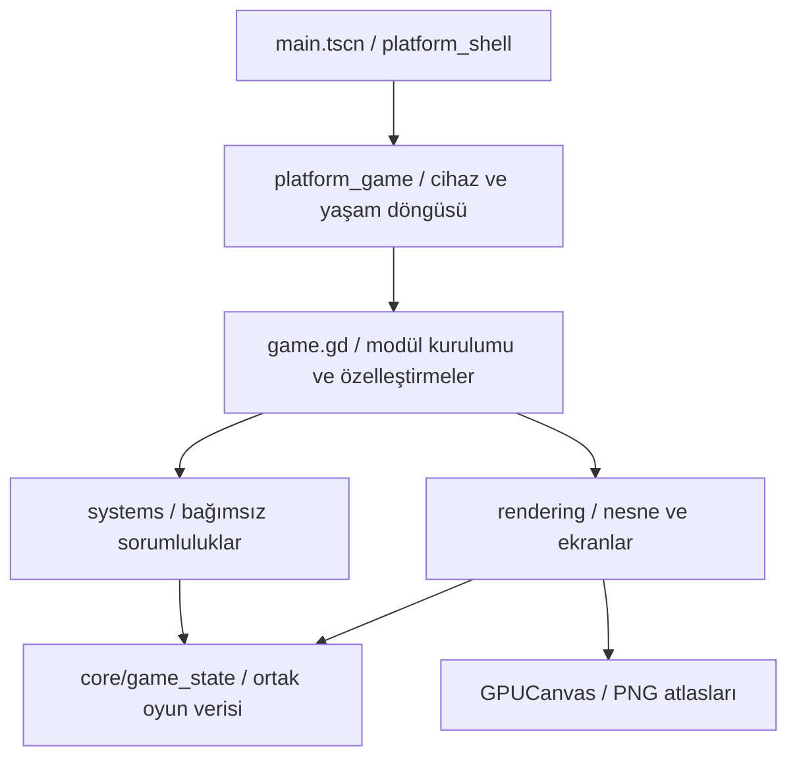

# Godot kod rehberi — 0.7.0

Oyunu `scenes/main.tscn` üzerinden çalıştır. Bütün davranış dosyaları doğrudan düzenlenebilir GDScript'tir; değişiklikten sonra kod üretimi veya HTML dönüştürme işlemi gerekmez. Godot'ta Dosya Sistemi panelinden aşağıdaki klasörleri açabilirsin.

## Oyun kuralları

Aşağıdaki yollar `scripts/` klasörüne göredir.

| Düzenlemek istediğin bölüm | Dosya ve başlangıç noktası |
| --- | --- |
| Müşterinin gelişi, beklemesi, ayrılması ve ödeme | `systems/customer_system.gd`: `f_spawnCustomer`, `f_updateCustomers`, `f_deliver`, `f_payCustomer`; yer yokken camın dışındaki sıra: `sira_guncelle`, `sira_x`, `kapidan_don` (çizimi `rendering/street_draw.gd`: `sira_yaya`) |
| Telefon siparişi ve kurye | `systems/customers/phone_system.gd`: `f_updatePhone`, `f_phoneClick`, `f_giveToCourier` |
| Dayı ve motor yardımı | `systems/customers/helper_system.gd` |
| Müşterinin rastgele yüz/kıyafet seçimi | `systems/customers/appearance_system.gd` |
| Tarif miktarları, temel fiyatlar ve kalite | `systems/recipe_system.gd`: baştaki sabitler; `f_makeOrder`, `f_wrapQuality`, `f_plateQuality` |
| Turşusuz/sossuz sipariş eşleşmesi | `systems/order_system.gd`: `order_matches`, `order_problem`, `order_bind` |
| Lavaş açma, tahta seçimi ve sarma | `systems/orders/wrap_system.gd`: `f_newWrap`, `f_activeWrap`, `f_finishRoll`, `f_applyPaper` |
| Et/malzeme ekleme, pide ve sos | `systems/orders/assembly_system.gd`: `f_addMeat`, `f_addIng`, `f_sauceClick` |
| Sürükleme ve eldeki ürünü geri bırakma | `systems/orders/drag_system.gd` |
| Döner kesme ve tepsiye et düşmesi | `systems/equipment/cutting_system.gd`: `MEAT_PER_CUT`, `f_updateShave`, `f_doSlice` |
| Patates doğrama ve kızartma | `systems/equipment/potato_system.gd`: `f_updateCut`, `f_updateFryer` |
| Izgara | `systems/equipment/grill_system.gd` |
| İçecek doldurma | `systems/equipment/drink_system.gd` |
| Kağıtla paketleme | `systems/equipment/paper_system.gd` |
| Patates kutusu doldurma | `systems/equipment/fries_box_system.gd` |
| Depo, kasa ve malzeme ikmali | `systems/equipment/stock_system.gd` |
| Makine otomasyonu sırası | `systems/equipment_system.gd`: `f_checkAuto` |
| Ekipman seviyeleri, süreler ve kapasiteler | `systems/equipment_tuning.gd`: `shave_cd`, `meat_cap`, `fry_time`, `paper_time` |
| Satın alma doğrulaması ve sonraki seviye önizlemesi | `systems/upgrade_system.gd`; fiyat dengesi: proje kökündeki `ECONOMY.md` |
| Geliştirmelerin isimleri ve fiyatları | `data/upg.gd` (proje kökünde) |
| Kayıt içeriği, yükleme ve devam etme | `systems/save_system.gd`; diske atomik yazma: `save_store.gd` |
| Gün başlangıcı/sonu ve sıfırlama | `systems/session_system.gd` |
| Gün zorluğu, şube ve ekonomi ayarları | `systems/progression_system.gd` |
| Para toplama ve para animasyonunun güncellemesi | `systems/payment_system.gd` |
| Hava, rakip, aile giderleri, lider ve denetim | `systems/events/`: `weather_system`, `rival_system`, `household_system`, `leader_system`, `regulation_system` |
| Çöp, kedi, elektrik kesintisi ve gece olayı | `systems/event_system.gd` |
| Başarım açma ve koşulları | `systems/achievement_system.gd`, `achievement_conditions.gd` |
| Şehir renkleri ve sokak trafiği | `systems/city_system.gd`, `traffic_system.gd` |

## Görseller

| Bölüm | `scripts/` altındaki dosya/klasör |
| --- | --- |
| Onaylanan tezgâhın güncel ölçüleri ve ekipman yerleşimi | `counter_design.gd` |
| Sipariş balonu, malzeme simgeleri, paket fişi | `rendering/order_draw.gd` |
| Döner ve kesim bıçağının temel çizimi | `rendering/food/spit_draw.gd` |
| Et/turşu/patates piksel parçaları ve tepsi altyapısı | `rendering/food/ingredient_pixels.gd`, `tray_draw.gd` |
| Tepsilerin içindeki malzemelerin yerleşimi | `rendering/ingredient_draw.gd` |
| Açık/sarılı dürüm ve tabak | `rendering/food/wrap_draw.gd`, `plate_draw.gd` |
| İçecek/patates bardağı, tatlı ve eldeki ürün | `rendering/food_draw.gd` |
| Fritöz, içecek, paketleme, sos, garnitür ve doğrama | `rendering/stations/` |
| Dayı, müşteri, kıyafet ve portre çizimi | `rendering/characters/`: `chef_draw`, `customer_draw`, `costume_draw`, `portrait_draw` |
| Yüzün ortak piksel yardımcıları | `rendering/character_draw.gd` |
| Sokak/bina, araç, yaya, pencere ve özel binekler | `rendering/street/` |
| Sokağın katmanlarını birleştirme | `rendering/street_draw.gd`; sıralanan nesne callback'leri: `street/street_actors.gd` |
| Dükkân arka planı ve temel tezgâh | `rendering/shop_background.gd`, `counter_draw.gd` |
| Oynanış sahnesini birleştirme | `rendering/game_draw.gd` |
| Hazırlama tahtası, bıçak ipucu ve depo paneli | `rendering/preparation_draw.gd` |
| Telefon/kurye, duvar süsü ve imza | `rendering/phone_draw.gd`, `decor_draw.gd`, `signature_draw.gd` |
| Hava, denetim ve dükkân olaylarının çizimi | `rendering/events/` |
| HUD, başlık, dil seçimi, ayarlar, gazete, başarımlar | `rendering/ui/` — dosya adları ilgili ekranı belirtir |
| Ortak panel/düğme ve mola çizimi | `rendering/interface_draw.gd` |
| Geliştirme mağazası ve gün sonu | `rendering/shop_draw.gd`, `day_end_draw.gd` |
| Hikâyenin her sahnesi | `rendering/story/`; sahne geçişleri: `rendering/story_draw.gd` |
| Logo ve piksel yazı | `rendering/logo_draw.gd`, `text_draw.gd` |
| PNG atlasları, pozlar ve önbellekler | `game_sprites.gd`, `sprite_library.gd`, `rendering/sprite_draw.gd` |

`rendering/ui/legacy_order_draw.gd` özgün sipariş balonunun temel çizimidir. Güncel oyunda `order_flow.gd` üzerinden `rendering/order_draw.gd` kullanılır. Benzer şekilde `rendering/stations/` temel çizimleri, `counter_design.gd` yeni tezgâh yerleşimindeki özelleştirmeleri içerir. Bir nesne için çalışan sürümün özelleştirmesini kontrol et.

## Ortak altyapı

- `game.gd` **311 satırdır**: modülleri oluşturur ve özelleştirilen çağrıları bağlar. Önceki 527 yönlendirme kaldırıldı. En uzun uygulama dosyası `rendering/characters/customer_draw.gd`, **509 satırdır**. Dosyalar fonksiyon ortasından veya sabit satır sayısıyla bölünmedi.
- `core/game_state.gd` **284 satırdır**: aynı oyun örneğinin ortak verileri. `game.j_G.meat` bütün modüllerde aynı tepsiyi gösterir. Modüller `core/game_module.gd` ile sahibine bağlanır; küresel singleton veya ayrı oyun kopyası oluşturulmaz.
- `core/game_setup.gd` başlangıç verilerini, `core/game_loop.gd` güncelleme/çizim sırasını, `core/math_utils.gd` matematik yardımcılarını tutar. Dil, ses ve efektler de `core/` altındadır.
- `systems/gameplay_input.gd` oyun alanındaki işlemleri; `device_input.gd` cihaz girdilerini; `station_actions.gd` bağlamsal istasyon eylemlerini yönetir. `platform_shell.gd` ekran ölçeği ve yerel arayüzdür.

Normal çağrılar doğrudan sorumlu sisteme gider:

```gdscript
# Oyun nesnesine erişen bir modül veya test içinden:
game.assembly_system.f_addMeat()
game.phone_system.f_updatePhone(delta)
game.save_system.f_saveAll()
```

**Özelleştirilen girişler korunur.** Örneğin `game.f_doSlice()` kesme stok işleminin yanında platform katmanındaki bıçak/`+3` geri bildirimini çalıştırır; `game.f_newWrap()` özel sipariş bağlar. Bunları doğrudan temel modüle çağrıya çevirmek özelleştirmeyi atlar. `game.gd` içinde kalan 65 giriş; bu özelleştirmeler, başlangıç ve görsel üretim araçlarının ihtiyaç duyduğu callback'lerdir.

`order_system.gd` içindeki `game.wrap_system.f_newWrap(...)` gibi bazı çağrılar özellikle temel işlemi çağırır. Bu çağrıları `game.f_newWrap(...)` yapmak aynı sipariş işlemine tekrar girer.



`f_` ve `j_` adları kaynak eşleştirmesi için korunmuştur. Eski `game.js:...` yorumları yalnızca referanstır; çalışan kod GDScript'tir. Eski özel scriptlerinde `game.f_addMeat()` gibi kaldırılan normal yönlendirmeler varsa yukarıdaki doğrudan modül yolunu kullan. Projedeki testler ve görsel üretim araçları yeni yollara uyarlandı.

## Sık yapılan değişiklikler

- **Bir kesişte verilen et:** `systems/equipment/cutting_system.gd` başındaki `MEAT_PER_CUT`. Şu anda 3; tepsi kapasitesi uygulanır. `game.gd` aynı sabiti dışarıya sunar.
- **Bıçağın temposu:** `systems/equipment_tuning.gd` içindeki `shave_cd`. `shave_dist` gereken hareket mesafesidir; `meat_per_click` dürüme eklenen maşa miktarıdır.
- **Tarif miktarı/fiyatı:** `systems/recipe_system.gd` başındaki sabitler. Porsiyon değiştirirken `order_system.gd` özel sipariş kontrolünü ve `order_draw.gd` göstergelerini de kontrol et; mevcut tarif dört birimliktir.
- **Müşteri yoğunluğu ve sabrı:** `progression_system.gd` içindeki `f_dayCfg`, `equipment_tuning.gd` içindeki `patience` ve `slots`; hareketler `customer_system.gd` içindedir.
- **Yeni kayıt alanı:** `save_system.gd` içindeki `f_saveAll` listesi, `f_loadAndGo` eski kayıt varsayılanı ve `core/game_setup.gd` / `session_system.gd` başlangıç değeri.
- **Pixelorama:** `art/pixelorama/` kaynakları ve `assets/sprites/` atlasları proje kökündedir; bu sürüm görselleri yeniden üretmez.

## Doğrulama

Godot'ta eski oturumu **F8** ile kapatıp **F5** ile başlat. Kayıt yolu ve şeması korunur.

```sh
godot --headless --path . --script tests/order_flow.gd --quit-after 600 -- --test
godot --headless --path . --script tests/cutting.gd --quit-after 600 -- --test
godot --headless --path . --script tests/module_services.gd --quit-after 600 -- --test
godot --headless --path . --script tests/module_snapshot.gd --quit-after 1200 -- --test
godot --path . --script tests/order_flow_visual.gd --quit-after 800 -- --test --gpu-test
```

`module_services.gd` bağımsız oyun örnekleri ve disk kaydını; `module_snapshot.gd` beş sahnenin pikselleri/oyun durumu ile kayıt içeriğini kontrol eder. 0.5.4'ten alınan referans görüntüler ve rastgele sayı durumu karşılaştırılır. Bilinçli görsel/kural değişikliklerinde referanslar ayrıca gözden geçirilmelidir. Güncel kapsam ve sonuçlar `VALIDATION.md` içindedir.
